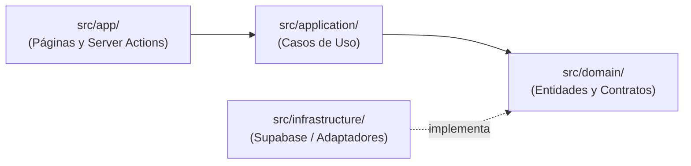

# 🏗️ Arquitectura y Organización de Carpetas — Telar Monitor

Este documento detalla la estructura del proyecto, la separación de responsabilidades y la diferencia conceptual entre las capas del sistema, especialmente entre `src/app` y `src/application`.

---

## 📌 Diferencia Clave: `src/app/` vs `src/application/`

Es común confundir ambas carpetas por la similitud del nombre, pero pertenecen a **dos dimensiones completamente diferentes** de la arquitectura:

| Aspecto | `src/app/` (Next.js App Router) | `src/application/` (Clean Architecture) |
| :--- | :--- | :--- |
| **Capa** | **Presentación / Entrega Web** (Framework Next.js) | **Lógica de Aplicación / Casos de Uso** (Negocio) |
| **Responsabilidad** | Define rutas, páginas, layouts, Server Actions y API endpoints HTTP. | Orquesta las reglas de negocio y flujos del sistema sin depender de Next.js ni React. |
| **Dependencias** | Depende de React, Next.js, HTTP, cookies, headers y componentes visuales. | Código TypeScript puro. Depende únicamente de las interfaces del `domain/`. |
| **Ejemplos** | `app/page.tsx`, `app/historico/page.tsx`, `app/login/page.tsx`, `app/actions.ts` | `GetDailySummary.ts`, `GetEnergyRate.ts`, `GetHistoricalReadings.ts` |
| **Interacción** | Llama a los casos de uso para obtener datos o disparar acciones. | Ejecuta la lógica requerida pidiendo datos a los contratos de repositorio (`domain`). |



---

## 📁 Estructura Completa del Directorio `src/`

```text
src/
├── app/                  # Capa de Presentación (Next.js App Router)
│   ├── (auth)/           # Rutas de autenticación (login, onboarding, callbacks)
│   ├── actions.ts        # Server Actions (mutaciones de servidor invocadas desde UI)
│   ├── globals.css       # Estilos globales de Tailwind CSS v4
│   ├── historico/        # Página /historico (tendencias, tablas y filtros de tiempo)
│   ├── ahorro/           # Página /ahorro (cálculo tarifario, retorno ROI, CO2)
│   ├── configuracion/    # Página /configuracion (gestión de hogar, miembros, PIN)
│   ├── layout.tsx        # Layout maestro raíz (Navbar, Sidebar, Providers)
│   └── page.tsx          # Dashboard principal (/)
│
├── application/          # Capa de Aplicación (Clean Architecture)
│   └── use-cases/        # Orquestadores de flujo de negocio
│       ├── GetDailySummary.ts         # Calcula agregados de energía del día
│       ├── GetEnergyRate.ts           # Obtiene tarifas activas
│       ├── GetHistoricalReadings.ts   # Recupera telemetría por rangos de tiempo
│       ├── GetLatestReadings.ts       # Lecturas en tiempo real instantáneas
│       └── GetMonthlyProjection.ts    # Proyecciones de gasto según consumo
│
├── domain/               # Capa de Dominio (El Núcleo - Core)
│   ├── entities/         # Modelos de datos del negocio puros
│   │   ├── EnergyReading.ts           # Tipo de lectura (consumption vs solar)
│   │   ├── Household.ts               # Propiedades del hogar y capacidad kWp
│   │   └── Setting.ts                 # Parámetros del sistema
│   └── repositories/     # Interfaces / Contratos abstractos
│       ├── EnergyReadingRepository.ts # Contrato para guardar y consultar lecturas
│       └── SettingsRepository.ts      # Contrato para configuración y tarifas
│
├── infrastructure/       # Capa de Infraestructura (Implementaciones Concretas)
│   ├── supabase/         # Clientes de Supabase y repositorios concretos
│   │   ├── SupabaseEnergyReadingRepository.ts
│   │   ├── SupabaseSettingsRepository.ts
│   │   ├── client.ts                  # Cliente browser de Supabase
│   │   └── server.ts                  # Cliente seguro de servidor con cookies
│   └── simulation/       # Motor opcional o adaptadores de hardware local
│
└── components/           # Componentes visuales reutilizables de React
    ├── DashboardRefresher.tsx         # Sincronización en vivo no bloqueante
    ├── EnergyBalanceCard.tsx          # Tarjeta dinámica solar vs red
    ├── HistoryChart.tsx               # Gráficas Recharts adaptativas (solar y red)
    ├── HouseholdOnboarding.tsx        # Pantalla de creación o unión por PIN
    ├── Navbar.tsx                     # Barra de navegación superior
    └── ui/                            # Primitivos UI (botones, modales, alertas)
```

---

## 🏛️ Principios y Reglas de la Arquitectura

1. **Regla de Dependencia Unidireccional:**
   - La UI (`src/app/`, `src/components/`) **NUNCA** consulta Supabase directamente.
   - Pasa a través de `src/application/use-cases/` o Server Actions en `src/app/actions.ts`.
2. **Independencia del Dominio:**
   - `src/domain/` no tiene dependencias de Next.js, React, Supabase ni bibliotecas externas.
3. **Sustituibilidad de Infraestructura:**
   - Si mañana se reemplaza Supabase por PostgreSQL directo, MongoDB o una API MQTT de inversores físicos (Fronius, Growatt, Enphase), **solo se implementa una nueva clase en `src/infrastructure/`**. Ni `domain/`, ni `application/`, ni `components/` sufren modificaciones.
4. **Soporte Dual en Presentación:**
   - Los componentes de `src/components/` evalúan si el hogar tiene paneles (`capacity_kwp > 0`) o solo red (`capacity_kwp === 0`) para adaptar métricas, colores y etiquetas automáticamente.
